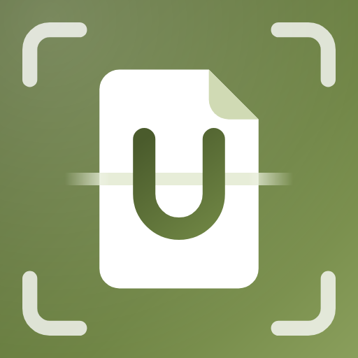
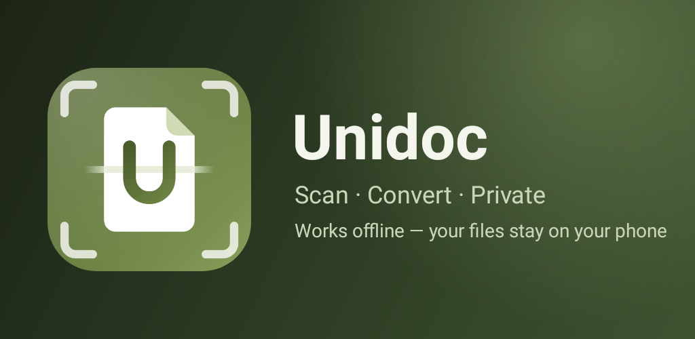
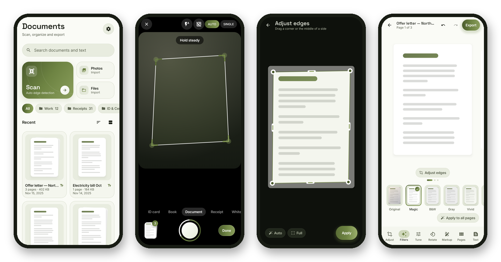
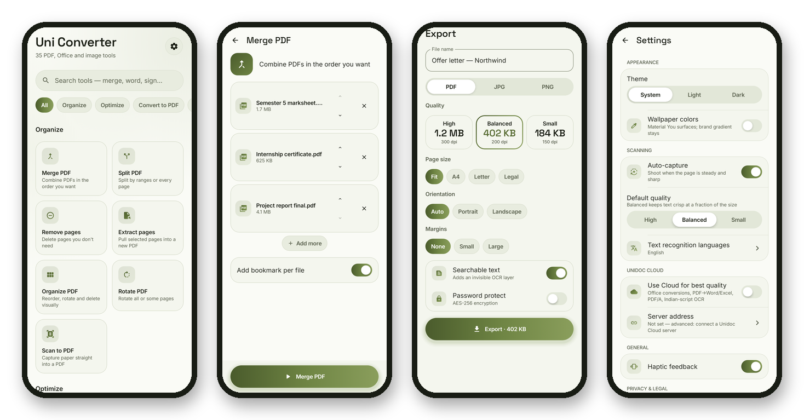
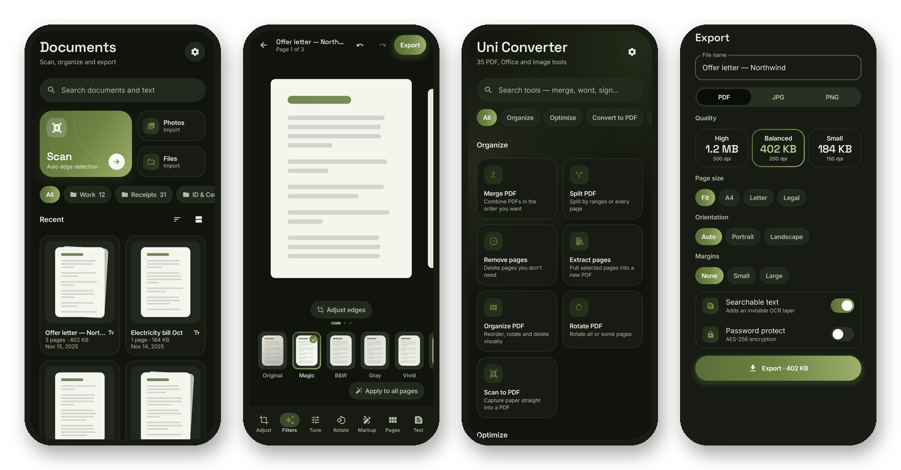

# Unidoc

### Scan anything. Convert everything. Share nothing you didn't choose to.

**No ads · No cloud · No accounts · No tracking · Works offline · Your files never leave your phone**

[Privacy Policy](https://rajdeep582.github.io/Unidoc/legal/privacy-policy.html) ·
[Terms of Use](https://rajdeep582.github.io/Unidoc/legal/terms-of-use.html) ·
[Contact](mailto:brajdeep029@gmail.com)

---

## Why Unidoc

Most scanner apps upload your papers to someone else's computer, show you ads, and ask you to sign in.
Unidoc does none of that. It turns your phone into a pocket scanner and a complete PDF toolkit,
and keeps everything on your phone.

| | Unidoc | Typical scanner apps |
|---|:---:|:---:|
| Ads | **None. Ever.** | Banners, pop-ups, video ads |
| Account / sign-in | **Not needed** | Required for most features |
| Your documents uploaded to a company server | **Never** | Often by default |
| Tracking & analytics SDKs | **None** | Common |
| Works with no internet | **Yes, everything except Web page → PDF** | Often partly |
| Watermarks on your PDFs | **Never** | On free tiers |
| Price | **Free** | Free with limits, then subscription |

> **Nothing to leak.** We don't run a server that stores your documents, and the app has no account database,
> so there is no copy of your papers on our side to breach.
> Your scans stay in the app's private storage until you choose to share them.

---

## Scan like a pro

- **Finds the page by itself**, even on busy, patterned or low-contrast backgrounds, and shoots when the page is steady.
- **Perfect crops.** Drag any of 8 handles with a magnifier. Pages come out flat, straight and in their true shape.
- **Crisp results.** Magic, Black & White, Grayscale and Vivid filters, plus brightness, contrast and sharpness.
- **Made for real life:** Document, ID card (front and back on one page), Book (two pages at once), Receipt,
  Whiteboard and QR modes.
- **Copy the text** from any scan with on-device text recognition (English and Hindi/Devanagari).
- **Export your way:** PDF, JPG or PNG, with quality presets, page size, margins and a password.

## A complete PDF toolkit

| Organize | Optimize & secure | Convert |
|---|---|---|
| Merge, split | Compress | Images → PDF (original quality) |
| Extract & remove pages | Repair | PDF → images |
| Reorder & rotate | Password-protect & unlock | Text → PDF / image |
| Crop pages | Watermark, page numbers | PDF → text |
| Add text anywhere | Sign | and more |

## Beautiful in the dark, too

A calm olive-and-white design with a full dark theme and smooth, native Android motion.
Text scales cleanly for larger font sizes.

---

## Privacy, in plain words

- **Camera** is used only while you scan. Deny it and you can still import photos and PDFs.
- **Files** are opened only when you pick them in the system file picker. The app has no access to your gallery or storage otherwise.
- **No contacts, location, microphone, SMS or call-log access.** The app never asks for them.
- **No cloud.** Every scan and every conversion runs on your phone. Unidoc never uploads your documents;
  the only network use is the *Web page → PDF* tool, which fetches the page you ask for.
- **Your data, your control.** Delete a document and it's gone. Uninstall and everything goes with it.

Read the full [Privacy Policy](https://rajdeep582.github.io/Unidoc/legal/privacy-policy.html).

---

## Get Unidoc

Unidoc 1.0.0 runs on Android 8.0 and newer.

<a href="https://github.com/Rajdeep582/Unidoc/releases/latest"><b>⬇ Download the latest APK</b></a> — signed release, about 75 MB.

Coming to **Indus Appstore**, **Samsung Galaxy Store**, **Huawei AppGallery**, **Xiaomi GetApps**,
**OPPO App Market**, **vivo App Store** and **Uptodown**. Store links will appear here as each listing goes live.

## Support

Found a problem or have an idea? Write to **[brajdeep029@gmail.com](mailto:brajdeep029@gmail.com)**.
For security issues, see [SECURITY.md](SECURITY.md).

---

Made with care in Kolkata, India 🇮🇳 by **Rajdeep Biswas**

© 2026 Rajdeep Biswas. All rights reserved. · [License](LICENSE)

